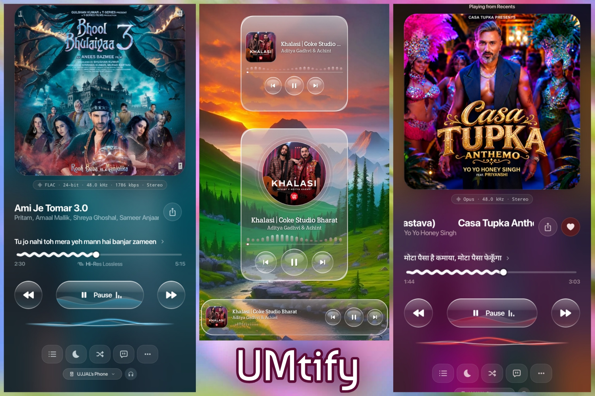

<div align="center">
  
</div>

<div align="center">

# UMtify

### *Your music, rebuilt in Liquid Crystal Glass.*

A lightweight, Android-only music streaming & local audio player — a personal fork of the open-source [BitChord](https://github.com/kushagrasinghx/BitChord) project, rebuilt around a refined Material 3 interface, crystal glass surfaces, and a distraction-free listening experience.

[](https://github.com/UjjalMallik/UMtify)
[](https://github.com/UjjalMallik/UMtify)
[](https://github.com/UjjalMallik/UMtify)
[](https://github.com/UjjalMallik/UMtify/actions)
[](https://github.com/UjjalMallik/UMtify/releases/latest)
[](https://github.com/UjjalMallik/UMtify/blob/main/LICENSE)

</div>

---

## ✨ Key Customizations & Features

| 🎨 **Crystal Glass Player UI** | 🌊 **Cover-Art Theme & Wave Ribbon** |
| --- | --- |
| Crystal glossy pill Play/Pause with an internal liquid wave, squiggly progress scrubber, strict 1:1 square cover art, and DPI-adaptive layout scaling. | A full Material You tonal palette extracted from the artwork, plus a smooth liquid ribbon below the transport controls that animates with playback and fades out when paused. |

| 💎 **Liquid Glass Widgets** | 🎛️ **Customizable Bottom Toolbar** |
| --- | --- |
| Three home screen widgets — *Crystal Vinyl*, *Now playing 2×2*, and *Now playing 4×1* — in frosted Liquid Crystal Glass with 3D crystal bubble buttons and live wave transitions. | A strict single-row action bar for queue, sleep timer, shuffle, lyrics, repeat, and more — hide the whole bar or toggle individual buttons in Settings. |

| 🏷️ **Metadata Editor** | 🧹 **Smart Cache Management** |
| --- | --- |
| Edit song title, artist, and album, set custom gallery cover art, and reset to the original metadata in one tap. | Configurable audio/media cache ceiling as low as **200 MB**, with automatic reset and cleanup the moment the limit is reached. |

| 📊 **"Stats for Nerds" Badge** | ⚡ **Lightweight & 120Hz Optimized** |
| --- | --- |
| A translucent, artwork-tinted glass pill reporting codec, bitrate, sample rate, and Automix analysis status. | **arm64-v8a** only, R8-shrunk with compressed native libraries, and frame-paced for buttery 120 Hz rendering. |

---

### 🎨 Redesigned Material 3 & Crystal Glass Player UI

A rebuilt Now Playing screen, from the transport controls down to the progress row:

- **Crystal glossy glass transport controls** — a pill-shaped Play/Pause button with an internal animated liquid wave, flanked by circular previous and next buttons.
- A **squiggly/wavy progress bar** with a draggable scrubber.
- A **strict 1:1 square cover art** ratio that never distorts, plus responsive layout scaling that adapts cleanly across every phone screen size and DPI without wrapping text or shrinking artwork.
- **Colours extracted from the current cover art**, with smooth crossfades on every track change.

> [!TIP]
> Every surface is drawn from the track's own palette, so the player re-themes itself the instant the song changes.

### 🌊 Dynamic Cover-Art Theme & Music-Reactive Wave Transition

A theme option alongside **System**, **Light**, and **Dark**, enabled by default. UMtify reads the dominant and accent colours of the current cover and builds a complete Material 3 tonal palette from them — primary, secondary, tertiary, surfaces, and every container role. The whole app moves with the music, and the palette crossfades smoothly when the track changes.

While music is playing, a smooth, continuous **wavy liquid ribbon transition** animates below the transport controls, paced by playback, and fades out cleanly when playback pauses. The feature respects the **Reduce animation** setting.

### 💎 Crystal Liquid Glass Home Screen Widgets

Three redesigned home screen music widgets, crafted with a translucent frosted **Liquid Crystal Glass** aesthetic, 3D glossy crystal bubble buttons, and music-reactive wave transitions:

- **Crystal Vinyl** — a spinning-disc style 3×3 widget with circular cover art and three big transport keys.
- **Now playing 2×2** — a true square card with cover art, title, artist, live wave, seek bar, and prev/play/next.
- **Now playing 4×1** — a slim capsule bar that fills a single launcher row, with auto-hiding artwork on narrow hosts.

### 🎛️ Customizable Bottom Action Toolbar (Hide / Show Controls)

A compact, strict **single-row** bottom action bar for queue, sleep timer, shuffle, lyrics, repeat, and more options — it stays one row on every screen size and DPI.

Settings carries the full customization: **hide or unhide the entire bottom toolbar**, or toggle which individual buttons appear in it.

### 🏷️ Custom Cover Art & Song Metadata Editor

Edit a track's **title, artist, and album name**, and set **custom cover artwork from the gallery** — for local files and downloaded tracks alike — with a **one-tap reset** back to the original metadata.

### 🧹 Smart Cache Management (200 MB Minimum Limit & Auto-Reset)

The audio/media cache has a configurable maximum that can be set as low as **200 MB**. Once the limit is reached, the cache is **reset and cleaned up automatically**, so listening never quietly fills the phone's storage.

### 📊 Clean "Stats for Nerds" Glass Badge

Audio details are shown in a compact glassmorphic pill directly below the cover art, styled as a centered Material 3 badge with a translucent artwork-tinted background, a hairline border, an equalizer icon, and monospace typography. It reports the active **codec, bitrate, and sample rate**, plus **Automix analysis status** when that feature is enabled. The badge can be toggled in Settings.

### ⚡ Lightweight & 120Hz Optimized (arm64-v8a)

- Built for **arm64-v8a** Android devices only, keeping the release APK small.
- Unused multiplatform modules removed, including Desktop, Web, TV, and native CMake targets.
- Background remote update checks and update popups disabled for a faster, distraction-free experience.
- Every build is signed with the same committed key, so new APKs install over older ones without uninstalling.
- Version codes default to the GitHub Actions run number — or the value chosen on a manual release — so updates always move forward.
- Release builds run through **R8** with resource shrinking, and native libraries are stored compressed, so the download stays small without giving up speed.
- The UI is frame-paced for **120 Hz** displays and stays smooth while scrolling, animating, and playing.

<details>
<summary><strong>🎵 Core playback</strong></summary>

- High-quality streaming
- Synced lyrics
- Local music playback
- Sleep timer
- Queue management

</details>

---

## 🚀 Download & Releases

**Every push to `main`** builds an optimized **arm64-v8a** APK in **GitHub Actions** and keeps it as the **`UMtify-arm64-v8a`** artifact on the run page. Those builds report the release-facing version `1.0` and never publish a release.

**Official releases** are published to **[Releases](https://github.com/UjjalMallik/UMtify/releases)** on demand:

1. Open the **Android Production APK** workflow on the [Actions](https://github.com/UjjalMallik/UMtify/actions) tab.
2. Click **Run workflow** and set:
   - `version_name` — the visible release version, e.g. `1.0` or `1.1`
   - `release_notes` — optional changelog (auto-generated if left blank)
   - `keep_old_releases` — leave off to keep only the newest previous release
3. Run it — or simply push a **`v*`** tag, which publishes a release named after the tag.

The internal `versionCode` is always `100 + <workflow run number>`, so every build sorts above the last and installs straight over whatever is already on the phone. The visible version can restart at `1.0` without ever being treated as a downgrade.

Download `UMtify-v<versionName>-arm64-v8a.apk` and sideload it; every build carries the same signing key, so it installs directly over the previous one.

[](https://github.com/UjjalMallik/UMtify/releases/latest)

---

## 🛠️ Build Locally

**Requirements:** JDK 17 and the Android SDK.

```bash
./gradlew assembleProdRelease
```

The APK is written to:

```text
app/build/outputs/apk/prod/release/app-prod-arm64-v8a-release.apk
```

> [!NOTE]
> The visible name can be overridden locally with `-PversionName=1.1` (or `VERSION_NAME`). The internal `versionCode` stays `100 + <run number>` on CI and `100` for local builds — that is what guarantees every update installs upward.

---

<div align="center">

## 🙏 Credits & License

UMtify is built on the open-source [BitChord](https://github.com/kushagrasinghx/BitChord) project. All credit for the original application, its architecture, and its upstream playback, streaming, lyrics, and library features goes to the BitChord developers and contributors. UMtify exists only as a customized derivative for personal use.

BitChord is licensed under the **GNU General Public License v3.0 (GPLv3)**, and UMtify is distributed under the same license. Original copyright remains with the BitChord developers; any redistribution must preserve the license and provide the corresponding source.

**UMtify** is an unofficial personal project and is not affiliated with YouTube, Google, or the upstream BitChord maintainers.

[⬆ Back to top](#umtify)

</div>
